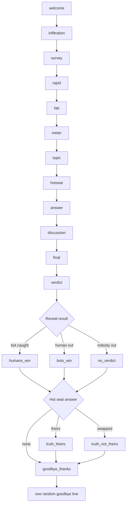
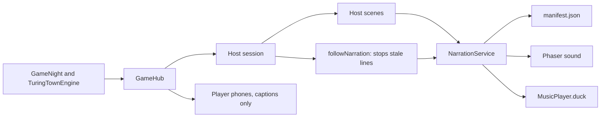

# Narration

26 recorded lines, played on the **TV only**. Phones never load or play them.

## Where things are

| What | Where |
|---|---|
| Recordings | `game/public/audio/turing-town/narration/<key>.mp3` |
| The list (key, category, file, title, transcript, duration) | `game/src/narration/manifest.json`, embedded by the server too |
| Client lookup | `game/src/narration/registry.js` |
| Playback queue, timeouts, de-duplication | `game/src/core/narration/service.js` |
| Phaser wiring and ducking | `game/src/core/narration/index.js` |
| Which line goes with which server state | `game/src/core/narration/scopes.js` |
| How each transition looks | `game/src/minigames/turing-town/data/transitions.js` |

`square.mp3`, `vote.mp3` and `stakes.mp3` in the same folder belong to the old tutorial and are no longer loaded.

## Sequence

| Lines | Played on |
|---|---|
| `welcome`, `infiltration` | the Tutorial stage's two steps |
| `survey`, `rapid`, `topic`, `hotseat`, `answer`, `verdict` | the `Transition` stage with that `beat` |
| `tap`, `meter`, `discussion`, `final` | said over their own screen (the first Voting, the meter Reveal, the final Discussion and Voting), with a caption (`HostStage.speak`) |
| the ending line | the final `Reveal` |
| the truth line | `Results` (`hotSeatWasTheirs`), queued behind the ending line |
| goodbye lines | the night's `Finale` |

A beat that is switched off by its timing option is not announced.

## Architecture

## Timing

- The six transitions come **before** an input or a reveal. The other four lines are said over the screen they
  describe, so they cost no extra time; they do overlap the first seconds of those votes and the final discussion.
- The TV reports `TransitionDone` when the line ends. The server also moves on after `TransitionMaxSeconds` (15), which
  `NarrationTests` keeps at least 3 seconds above the longest transition line (`survey`, 10.4 s).
- Nothing else waits for audio. A missing, blocked (autoplay) or silent line leaves the caption and the usual timing.
- The ending line can outlast the 8 s Reveal; it carries on into Results. Leaving Results, the Finale or the room cuts it.

## Goodbye

The server picks one of eight lines when the Finale starts (`NarrationManifest.PickGoodbye`), never the one the room
heard last time, and sends its key in `FinaleData.goodbye`. The TV says `goodbye_thanks` and then that line; the TV and
phones show both.

## Volume

With music playing, a line waits until the music has dipped (`MusicPlayer.msUntilDucked`, at most `duckDownMs`,
250 ms) and then plays; a run of lines keeps it down, so only the first waits. A track that starts during a line (the
Finale's) starts already low.

The host's volume slider (Phaser's master volume) applies. Music ducks to `AUDIO_MIX.duckFactor` while a line plays.
The host can pause a game only on the server; the client does not pause audio.

## Adding or replacing a line

Replace the MP3, then update its `transcript` and `durationMs` in the manifest. Run `npm test` in `game/` and
`dotnet test`.

## Manual test

Build (`npm run build` in `game/`), `dotnet run`, open the TV and at least two phones, and click on the TV once.

- [ ] Both opening lines, then the survey line once.
- [ ] Each transition line matches its screen; phones stay silent.
- [ ] Music dips under each line and comes back; the volume slider affects the voice.
- [ ] Skip from the first phone mid-line: the voice stops.
- [ ] Final reveal: one ending line (try catching a bot, voting out a human, and a tie), then the truth line.
- [ ] Finale: "Thanks for playing!" then one line that matches the text. Play again: a different line.
- [ ] Return to the lobby mid-line: silence. Start another game without refreshing.
- [ ] Block `localcdn.t3.tigrisfiles.io`: everything still plays.
